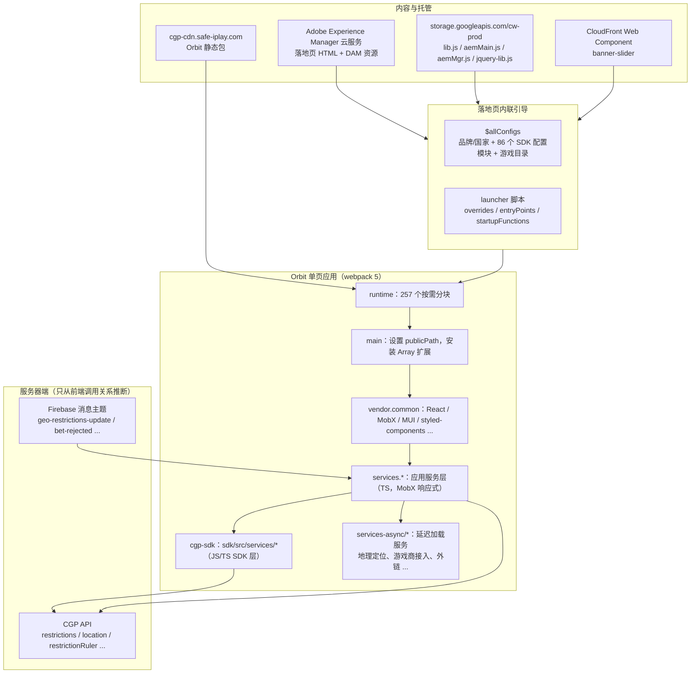
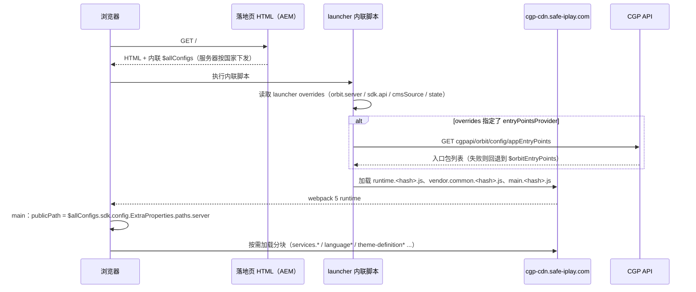

# 03 Orbit 平台架构

Orbit 是 888 集团（现 evoke plc）的赌场前端平台。webpack 全局变量名是 `webpackChunkorbit`，888casino 和 Mr Green 两个品牌共用同一份构建。

各节标注了依据类别（REA 观察 / 公开元数据 / 源码阅读 / 推断），见 [01-scope-and-method.md](01-scope-and-method.md#证据分级)。

## 1. 总体分层

## 2. 托管与内容层

| 观察 | 依据 |
|---|---|
| 落地页由 Adobe Experience Manager 云服务发布：HTML 中有 `data-routing="program=73704,environment=696678,tier=publish"`，资源路径为 `/content/dam/holdings888/...` | 公开元数据 |
| 接入了 Adobe 的真实用户监控：加载 `rum.hlx.page/.rum/@adobe/helix-rum-js@^2/dist/micro.js` | 公开元数据 |
| AEM 侧的辅助脚本放在 Google Cloud Storage：`cw-prod/lib.js`、`cw-prod/aemMain.js`、`cw-prod/jquery-lib.js`（888），`cw-prod/mrgreen-websites/aemMgr.js`（Mr Green，约 382 KB，注册了 `top-games-slider`、`banner-carousel`、`particles-effect` 等自定义元素） | REA 观察（`ev_d2c7b07e…`） |
| 横幅轮播是 CloudFront 上的 Web Component：`web-component/v3/banner-slider/banner-slider.esm.js` 静态导入 `p-CQHxgeEf.js`、`p-DQuL1Twl.js`。`p-<hash>.js` 的命名方式像 Stencil 构建产物 | REA 观察（分块边）+ 推断（Stencil） |
| 888 的 `safe-iplay.com` 域名族：`cgp`、`cgp-cdn`、`cr-sdk`、`loyalty`、`casino-grsgames-cdn`、`casino-staticcontent`、`triple8messages-prod` | 公开元数据 |
| 图片 CDN 域名族：`images.images4us.com`、`toaster.images4us.com`、`imagesstg.images4us.com` | 公开元数据 |
| 其他第三方：GeoComply（`cdn.geocomply.com`、`ums.geocomply.com`）、宣传视频流（`*.cdn.ptlive.video`、AWS MediaPackage）、AppsFlyer OneLink（`888casino-ca.onelink.me`） | 公开元数据 |

## 3. 页面引导流程

内联脚本按出现顺序依次是：

1. `webData`：站点类型版本等全局数据。
2. `sCut` / `sCutScript`：Cookie 读写工具。
3. GTM 数据层初始化（`pageLoadedDataLayer`）。
4. `funnel-data-v5.min.js`：推广归因，见第 8 节。
5. `$allConfigs`：在 888 落地页上约 3.6 MB，是页面最大的组成部分。
6. `$orbitEntryPoints = ['static/js/runtime.56d412df.js', 'static/js/vendor.common.959660fa.js', 'static/js/main.63d22730.js']`
7. `window.orbitStartupFunctions`：`isCip()`、`isCis()`（"mini Orbit"嵌入路径 `/cip`、`/cis`）、`isProgressiveWebApp()`、`isHybridEmbedded()`。

依据：公开元数据（HTML）+ 源码阅读（`main.63d22730.js.map`：`index.tsx`、`orbit-startup-functions.ts`、`launcher/utils/launcher-constants/launcher-constants.ts`、`utils/hybrid-utils.ts`、`utils/qa-mode-utils.ts`、`load-jquery-for-automation.ts`）。

### `$allConfigs` 结构

只记录键和大小，不含任何值。完整清单见 [data/orbit/allconfigs-structure.json](../data/orbit/allconfigs-structure.json)。

| 键 | 说明 |
|---|---|
| `brandId` / `subBrandId` / `skin` / `skinOverride` | 品牌标识；888casino.com 上是 `skin: "888casino"`、`skinOverride: "com"` |
| `country` / `useCountryAsState` / `userSelectedState` | 服务器判定的国家（分析时是 `jpn`）；美国、加拿大等按州/省监管的场景会用到 state |
| `sdk.config` | **86 个配置模块**，见下表 |
| `adminConfig.gamesTags` | 游戏标签（数字 ID 形式） |
| `adminConfig.arenas` | 16 个游戏分区：`slots`、`casinoGames`、`liveCasino`、`homePage`、`blackjack`、`roulette`、`videoPoker`、`scratchCards`、`jackpots`、`instantWinGames`、`exclusive888Games`、`virtualSport`、`newGames`、`newLiveCasino`、`videoSlidesArena`、`newLiveCasinoAB` |
| `orbit` | 空对象（分析时） |

`sdk.config` 的 86 个模块按职能分组（分组是作者归纳的）：

| 分组 | 模块 |
|---|---|
| 合规与监管 | `Regulation`、`Restrictions`、`RestrictionRuler`、`GeoLocation`、`GamblingSession`、`PlayerBurnout`、`Clock`、`Country`、`DomainDetection`、`Validation`、`ExitGamePopup` |
| 账户与身份 | `User`、`OAuth2`、`WebLogin`、`OpenSessions`、`PendingActions` |
| 资金 | `Wallet`、`Currency`、`NetPosition`、`Cashdrop`、`NewHeaderCashierButtons` |
| 游戏目录与运行 | `GamesInformation`、`Game`、`GameManager`、`GameConversion`、`GamesCorrelation`、`GameTiles`、`Filters`、`History`、`LiveTables`、`LiveVideoStream`、`VideoSlides`、`InGameExperience`、`InGameChallenges` |
| 游戏商接入 | `Blueprint`、`Evolution`、`NYX`、`PariPlay`、`PlayNGo`、`PlayTech`、`RedTiger`、`TripleEight`、`Gnwp`、`Integration`、`FreePlay`、`ThirdPartyFreePlay` |
| 头奖 | `JackpotFeeds`、`JackpotToasters`、`JackpotToaster`、`JackpotBets`、`JackpotDropStakeSelector`、`CasinoOrbitFeeds`、`WinnersFeed` |
| 营销与留存 | `Loyalty`、`DailyDeal`、`PlayerOfferings`、`PromotionsWidget`、`StickyPromotionalBanner`、`Leaderboards`、`PlayerMessages`、`CrmSdk`、`WebPush`、`OnBoardingTooltips`、`IdleRecommendations`、`AbTesting`、`ArenaBannerTest` |
| 搜索与推荐 | `OpenSearch`、`AiSearch`、`AiList` |
| 迁移 | `PlayerMigration`、`MigratedHistory`、`WinnerMigration` |
| 平台与壳 | `Skin`、`Language`、`Hybrid`、`HybridVersionHandler`、`AppLauncher`、`Http2`、`Fallback`、`ExtraProperties`、`QAEnvironmentPopUp`、`Omg` |
| 可观测性 | `Analytics`、`Logger`、`StructuredLogging`、`Trackjs` |

### 游戏目录（`sdk.config.GamesInformation`）

- 规模：`gamesInfo` 有 4134 条，`vendors` 155 个，`companies` 18 个，`themes` 37 个。
- 每条游戏记录的字段：`Id`、`Title`、`VendorId`、`CompanyId`、`Group`、`GroupId`、`HasJackpot`、`IsJackpotBet`、`AllowDemo`、`HasFreeSpins`、`PlatformType`、`Bets`、`GameThemes`、`Volatility`、`Approvals`、`ExtId`。
- `vendors` 是"厂商 → 子工作室"的映射，例如一个聚合商下挂多个子工作室。

依据：公开元数据（HTML 内联配置）。

## 4. webpack 构建与分块

- 构建工具是 webpack 5。runtime 的 source map 里有 jsonp 分块加载、CSS 分块加载、nonce、publicPath 等运行时模块。
- 入口三件套：`runtime.56d412df.js`（约 14 KB）、`vendor.common.959660fa.js`（约 547 KB）、`main.63d22730.js`（约 5 KB）。
- runtime 登记了 **257 个按需分块，其中 175 个有名字**。完整清单见 [data/orbit/chunk-inventory.tsv](../data/orbit/chunk-inventory.tsv)。

依据：公开元数据 + REA 观察（`ev_574afece…`：恢复出 26 个 webpack 分块记录、177 个 `webpackChunkorbit` 模块工厂、10 个 bootstrap 模块）。

按名称分组（分组是作者归纳的）：

| 分组 | 分块 |
|---|---|
| 核心 / 壳 | `orbit-main`、`orbit-prod`、`orbit-qa`、`launcher`、`cgp-sdk`、`services.core`、`services.core-ui`、`services.app-shell`、`services.config`、`services.http`、`services.script_loader`、`services.observable_factory`、`services.orbit_component_renderer`、`services.pages`、`services.navigation`、`services.links_navigation_proxy`、`services-group1..5`、`services.others`、`assets-map` |
| 第三方库 | `vendor.react`、`vendor.mobx`、`vendor.mui`、`vendor.gsap`、`service-gsap`、`vendor.pixi`、`vendor.pixi-spine`、`vendor.lottie`、`vendor.swiper`、`vendor.hls`、`vendor.toastify` |
| 合规 | `services.regulation`、`services.compliance`、`service-geolocation`、`service-ip-detection`、`services.player-migration` |
| 游戏 | `services.game`、`services.gaming`、`service-game-runner`、`services.games_information`、`service-game-search`、`service-vertical-games-list`、`services.live_tables`、`services.recently_played`、`services.game_reason`、`service-jackpots`、`service-red-tiger` |
| 游戏商接入 | `service-companies`、`company*`（12 个）、`generic-regulated-company*`（37 个）、`service-casinofied-app-launcher`、`service-open-sessions` |
| 资金 | `services.cashier_proxy`、`services.cashdrop`、`service-daily-deal` |
| 营销与互动 | `services.marketing`、`services.player-engagement`、`services.user-centric`、`services.ab_testing`、`services.web_push`、`services.player_messages_service`、`services.toaster`、`service-adm-banner` |
| 账户 | `services.oauth`、`services.web_login_proxy`、`service-user-menu`、`service-side-menu`、`service-drawer` |
| 可观测性 | `services.analytics`、`service-analytics-data-layer`、`services.trackjs`、`service-web-vitals`、`services.structured_logging` |
| 宿主环境 | `services.hybrid`、`hybrid-prod`、`hybrid-qa`、`service-progressive-web-app`、`services.mini-orbit`、`service-client-device`、`services.domain_detection`、`services.window`、`services.resize_detector`、`services.visibility_detector`、`services.query_string_detector` |
| 国际化与主题 | `language*`（18 个）、`theme-definition*`（8 个）、`theme-default-boxes`、`icons.default`、`services.translation_proxy`、`services.currency`、`services.country`、`services.skin` |
| 媒体 | `services.video-and-animations` |
| 代理层 | `services.dialog_proxy`、`services.spinner_proxy_service`、`services.external_links_proxy`、`service-external-links`、`services.externals`、`services.integration` |

## 5. 源码组织

从 source map 的原始路径可以看出四层结构。本项目只下载了入口三件套和 8 个合规相关分块的 source map，共 385 个原始源文件，清单见 [data/orbit/source-paths.tsv](../data/orbit/source-paths.tsv)。

| 目录 | 职责 | 例子 |
|---|---|---|
| `sdk/src/services/*` | 底层 SDK（JS 与 TS 混合，用 `BaseObject.create(params)` 风格的工厂），对应 `cgp-sdk` 分块 | `regulation/regulation_service.js`、`regulation/regulations/regulation_factory.js`、`cashier_proxy/cashier_proxy_service.ts`、`player-migration/player_migration_proxy_service.ts` |
| `services/*` | 应用服务层（TypeScript + MobX，`ServiceBase`、`reaction`、`@observable`） | `services/compliance/...` |
| `services-async/*` | 延迟加载的服务 | `geo-location/...`、`ip-detection/...`、`companies/...` |
| `components/common/*` | React 组件（`.tsx`）与"box"布局单元（`.box.ts`） | `components/common/compliance/geo/...` |

依据：公开元数据（source map 路径）+ 源码阅读（类名与基类）。

## 6. 技术栈

`vendor.common` 的 source map 里有 226 个原始源文件，用到的 npm 包见 [data/orbit/vendor-packages.tsv](../data/orbit/vendor-packages.tsv)：

| 用途 | 包 |
|---|---|
| UI 框架 | React（`vendor.react`）、MobX（`vendor.mobx`）、MUI（`vendor.mui`）、styled-components、prop-types、classnames |
| 路由 | `@remix-run/router`（React Router 6 的核心） |
| 动画与渲染 | GSAP、PIXI.js + pixi-spine（`earcut` 是 PIXI 的三角剖分依赖）、Lottie、Swiper |
| 视频 | hls.js |
| 认证与工具 | jwt-decode、qs、uuid、md5、lodash、eventemitter3、fuse.js（游戏模糊搜索）、accounting（金额格式化）、cssjanus（RTL 镜像） |
| 设备与兼容 | ua-parser-js、ismobilejs、@juggle/resize-observer、intersection-observer、smoothscroll-polyfill、url-search-params-polyfill |
| 可观测性 | trackjs（前端错误监控）、web-vitals、js-logger |
| 内部包 | `@sparkware/app-utils`（Sparkware 是 888 的技术部门）、`@888webteam/iframe-allow-camera` |

REA 还在 `vendor.common` 里观察到一个模块 Worker 池：`new Worker(this._workerUrl, {type: "module"})`，并发数取 `min(navigator.hardwareConcurrency, 8)`（REA 观察 + 源码阅读）。

## 7. 游戏商接入架构

从 `company1` 和 `generic-regulated-company10` 两个分块的 source map 看，每家游戏商的接入拆成三部分：

| 组件 | 路径模式 | 职责 |
|---|---|---|
| URL 构建器 | `services-async/companies/game-url-builders/<厂商>/...` | 生成游戏启动 URL（另有通用的 `game-context-gnwp-url-builder.ts`、`game-url-from-api-response.builder.ts`） |
| 厂商模型 | `services-async/companies/companies-models/<厂商>/...` | 厂商级配置与行为 |
| 通信通道 | `services-async/companies/game-communication-channels/<厂商>/...` | 与游戏 iframe 之间的 postMessage 协议，例如 `play-n-go-post-message-consts.ts` |
| 受监管变体 | `services-async/companies/regulated-companies/<国家>/<厂商>/...` | 同一厂商在特定辖区的行为差异，例如意大利 |

- 12 个 `company*` 分块对应基础厂商接入，37 个 `generic-regulated-company*` 分块对应"辖区 × 厂商"的组合（推断，依据是命名规律和已下载的两个样本）。
- `sdk.config` 里也有 `Evolution`、`PlayNGo`、`PlayTech`、`RedTiger`、`NYX`、`PariPlay`、`Blueprint`、`TripleEight` 等厂商配置模块。

依据：源码阅读（路径）+ 公开元数据。

## 8. 数据统计与归因

| 组件 | 观察 | 依据 |
|---|---|---|
| Google 跟踪代码管理器 | 通过第一方子域加载：`analytics.888casino.com/gtm.js?id=GTM-PQ2ZJ7J`、`gtag/js?id=G-X6C1J411V3`，另有 `_/service_worker/.../sw_iframe.html`（第一方 tag 网关）；Mr Green 对应 `analytics.mrgreen.com`、`GTM-TJCRMXQ`、`G-82EF5XEG2T` | REA 观察 |
| 地理同意 | GTM 与 gtag 中有 `fetch("https://www.google.com/ccm/geo")` | REA 观察（接口候选） |
| 推广归因 `funnel-data-v5.js` | 888casino 与 Mr Green 加载的是同一个文件（sha256 `1c641eb0…`）。source map 公开，其中的名字表显示：读取白名单内的 URL 参数（`allowedParameters`、`serial`、`lang`），写入带过期时间和修改计数的 `testData` Cookie，通过 gtag 获取 GA 的 `client_id`/`session_id`，并收集 Facebook 的 `fbp`/`fbc` | REA 观察（`ev_f162dbd6…`，source map 状态 `included`） |
| 错误与性能 | `services.trackjs`、`service-web-vitals`、`services.structured_logging` | 公开元数据 |

REA 的 `analyze_web_bundle` 报出的"接口候选"（888casino 36 条、Mr Green 46 条），都是 GTM/gtag 内部 `Map.get()` 和 `customElements.get()` 调用造成的低置信度误报，不是真实接口。

## 9. 宿主环境：混合 App、PWA 与"mini Orbit"

- 同一份前端支持多种宿主：浏览器、PWA（`service-progressive-web-app` 分块；内联启动函数 `isProgressiveWebApp()` 通过 `display-mode: fullscreen` / `standalone` 判断）、原生 App 内嵌（`Hybrid`、`HybridVersionHandler`、`isHybridEmbedded`），以及嵌入其他页面的"mini Orbit"（`/cip`、`/cis` 路径）。
- `Hybrid` 配置里有 BloomReach 推送（iOS/Android 分别配置）、OnDemand 远程加载、3D Touch 快捷方式等。
- `Skin.enforceHybridAppForMobileWeb`、`Skin.preventOpenGameOnMobileWeb` 两个开关可以强制移动网页端改用 App，或禁止在移动网页端打开游戏（源码阅读：`regulation.service.ts`）。

依据：公开元数据 + 源码阅读。
