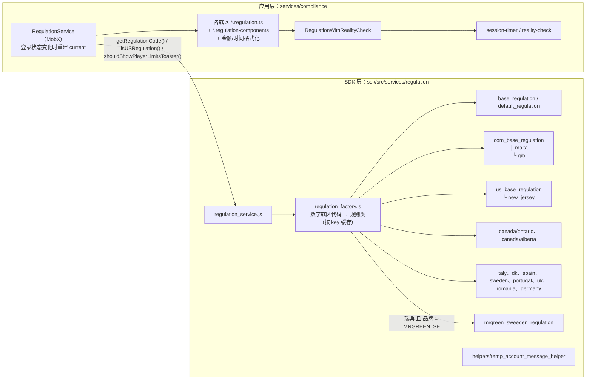

# 04 Orbit 合规架构

本文依据 Orbit 公开 source map 中的原始路径和源码（只引用类名、文件路径、常量名），加上 REA 对已下载包做的应用级重建（`ev_574afece…`）。只覆盖已下载的分块：`services.regulation`、`services.compliance`、`service-geolocation`、`service-ip-detection`、`services.player-migration`、`services.cashier_proxy`，以及两个游戏商分块。完整路径见 [data/orbit/source-paths.tsv](../data/orbit/source-paths.tsv)。

## 1. 核心设计：服务器执行，前端展示

各个合规功能的源码呈现出同一个模式：**判定和执行都在服务器端，前端负责展示、计时显示、上报和引导**。

| 功能 | 由谁执行 / 判定 | 前端做什么 | 依据 |
|---|---|---|---|
| 德国会话冷却 | 服务器接口 `restrictionsController.setCoolDownRestriction({CoolDownTimeInSeconds})` | 弹出冷却窗口，倒计时到期时间存在 localStorage 的 `orbit-session-cooldown-expiration-date` 里，只用于显示 | `germany-session-cooldown.handler.tsx` |
| 地理踢出 | 服务器经 Firebase 消息主题推送 `geo-restrictions-update`，`KickReasonId` 不为 0 即踢出 | 校验事件有效，展示对应弹窗 | `geo-kick-reasons.ts` |
| 会话计时 | 服务器保存会话时长（`_readSessionTimerFromServer`） | 本地每 5 秒累加显示值；心跳间隔 1 分钟（低频）或 15 秒（高频）；会话重置的判定阈值是 30 秒 | `session-timer.service.ts`、`session-timer-constants.ts` |
| 限制规则（已登录） | 服务器经 Firebase `restrictionsUpdate` 推送 | 维护 `RestrictionsCollection`，据此禁用对应的入口 | `authorized-user-restrictions.strategy.ts` |
| 限制规则（匿名） | 页面配置加服务器 | 同上 | `anonymous-user-restrictions.strategy.ts` |
| 资金来源核查（SOF） | 服务器 `restrictionRulerController.getRestrictionActions({RequestedAction: LOGIN_ACTION})` | 登录后（排除刚注册完成的登录），且该辖区开启了 `RestrictionRuler.enableSOF` 时，展示资金来源提示，并回报"动作已执行" | `restriction-ruler.service.tsx` |
| 奖金滥用 / 停泊资金 | 服务器拒绝下注，经 Firebase `betRejected` 推送，原因码为 `BonusAbuseInSport`、`BonusAbuseInPoker`、`BonusAbuseInSportAndPoker` | 弹出不可关闭的提示，显示真钱余额，并上报统计事件 | `bonus-abuse-money-parking.service.ts` |
| IP 变化检测 | 服务器 `locationController.detectUserIpV2`，比较上次记录的加密 IP | 只在本地保存服务器返回的加密 IP 令牌；退出登录时清除 | `ip-detection.service.ts` |
| 责任博彩通知 | 服务器经 Firebase 推送 | 登录后订阅、退出后取消订阅，收到后展示 | `rg-notification.service.ts` |

这个设计意味着：篡改前端状态（比如改 localStorage 里的倒计时）只会改变显示，不会解除服务器端的限制。

## 2. 两层监管模型



- **SDK 层**：`RegulationFactory.getRegulation(regulationCode)` 把数字形式的辖区代码映射到具体的规则类，每个辖区还有一个 CSS 后缀（`REGULATION_SUFFIX`），可以按辖区切换样式。瑞典有分支：品牌 ID 是 `BRANDS.MRGREEN_SE` 时用 `MrgreenSwedenRegulation`，否则用 `SwedenRegulation`。瑞典规则另有自己的结构化日志模块（`sweden_structured_logging.js`）。
- **应用层**：`RegulationService` 在 `user.isAuthorized` 变化时重新创建当前规则对象，并执行 `showPostLoginPendingAction()`，也就是登录后必须先处理的事项。它还对外提供 `shouldShowPlayerLimitsToaster()`、`isUSRegulation()`，以及"强制移动网页端改用 App"等开关。

## 3. 辖区与功能对照表

根据 `services/compliance` 的文件路径整理。"✓"表示存在对应的源文件；"—"表示本项目已下载的分块里没有看到，不代表该辖区没有这项功能。

| 辖区 | SDK 规则类 | 应用层规则类 | 专用 UI 组件 | 现实检查展示器 | 专用格式化 | 其他 |
|---|---|---|---|---|---|---|
| 英国 | ✓ `uk_regulation.ts` | ✓ | ✓ | ✓ 弹窗 | — | 专用外链处理；`shouldShowExitGamePopup = false`；`showIGCProgressPercentage = false` |
| 德国 | ✓ | ✓ | ✓ | ✓ 弹窗 | — | **强制冷却**：`germany-session-cooldown.handler`，默认 5 分钟，可由 `Regulation.sessionCooldownTime` 配置 |
| 意大利 | ✓ | ✓ | ✓ | ✓ Toast | — | 游戏历史记录详情组件（`italy-gaming-history-record-info`） |
| 西班牙 | ✓ | ✓ | — | — | — | |
| 葡萄牙 | ✓ | ✓ | ✓ | — | — | |
| 罗马尼亚 | ✓ | ✓ | — | ✓ Toast | — | |
| 瑞典 | ✓（+ Mr Green 专用） | ✓ | ✓ | ✓ 时长 + 余额弹窗 | — | 结构化日志 |
| 丹麦 | ✓ | ✓ | ✓ | ✓ 时长 + 余额弹窗 | — | |
| 马耳他（.com） | ✓（继承 `com_base`） | ✓ | — | ✓ 时长 + 余额弹窗 | — | |
| 直布罗陀（.com） | ✓（继承 `com_base`） | ✓ | — | — | — | |
| 加拿大安大略 | ✓ | ✓ | ✓ | — | ✓ 金额格式 | |
| 加拿大阿尔伯塔 | ✓ | ✓ | ✓ | — | ✓ 金额格式 | |
| 美国新泽西 | ✓（继承 `us_base`） | ✓ | ✓ | — | ✓ 美式时间格式 | |

推断：

- 英国关闭了"游戏内挑战进度百分比"（`showIGCProgressPercentage = false`），可能和英国对游戏化元素的监管要求有关。
- 美国和加拿大的辖区按州或省划分，所以有 `state-of-residence-identifier` 服务（见第 6 节）。

## 4. 现实检查（Reality Check）

```
services/compliance/session-timer/
├─ session-timer.service.ts            会话计时（服务器为准，本地累加显示）
├─ session-timer-constants.ts          5 s 累加 / 60 s 或 15 s 心跳 / 30 s 重置阈值
├─ session-timer-analytics.ts
└─ reality-check/
   ├─ handlers/
   │  ├─ standard-reality-check-handler.ts
   │  ├─ void-reality-check-handler.ts          不需要现实检查的辖区用空实现
   │  ├─ reality-check-occurrence-calculator.ts
   │  └─ reality-check-last-occurrence-storage.ts
   ├─ presenters/                              展示形式与各辖区文案
   │  ├─ reality-check-dialog-presenter-base.ts      ← uk、germany
   │  ├─ reality-check-toast-presenter-base.ts       ← italy、romania
   │  └─ time-spent-reminder-with-balance-presenter.ts（继承弹窗基类）← sweden、denmark、malta
   └─ cooldown/
      ├─ void-session-cooldown-handler.ts
      └─ germany/germany-session-cooldown.handler.tsx
```

- **何时触发**：`reality-check-occurrence-calculator.ts` 用"锚点 + 固定间隔"计算当前应该是第几次提醒（`computeOccurrenceIndex`）。如果会话计时出现回退，且超过重置阈值，就判定会话已重置（`isSessionTimerReset`），并重新确定锚点。
- **策略模式**：处理器决定"何时提醒"，展示器决定"怎么提醒"，冷却处理器决定"提醒后是否强制休息"。不需要某项功能的辖区用 `void-*` 空实现，所以业务代码里不需要写辖区判断。

依据：源码阅读。

## 5. 地理定位

```
services-async/geo-location/
├─ geo-location.service.tsx
├─ strategies/
│  ├─ plugin/   geo-comply-plugin-client.ts, geo-location-plugin.strategy.tsx   桌面端：GeoComply 本地插件
│  ├─ html5/    geo-comply-html5-client.ts, geo-location-html5.strategy.ts      浏览器 HTML5 定位 + GeoComply
│  └─ native/   geo-location-native.strategy.ts                                 原生 App 内嵌
└─ geo-runner/
   ├─ geo-location-runner-base.ts
   ├─ geo-location-runner-in-casino.tsx       赌场品牌内运行
   ├─ geo-location-runner-in-other-brands.ts  其他品牌内运行
   ├─ platform-geo-location-validator.ts
   ├─ geo-location-dialogs-factory.tsx
   └─ geo-kick-reasons.ts                     Firebase geo-restrictions-update，KickReasonId ≠ 0 即踢出
components/common/compliance/geo/
├─ geo-install-plugin/   提示安装定位插件的弹窗
├─ geo-freeze/           地理冻结弹窗
└─ game-restriction-popup/  因位置限制某个游戏的弹窗
```

- 页面直接加载了 `cdn.geocomply.com`、`ums.geocomply.com`（888casino 与 Mr Green 都有）。
- 定位方式按宿主选择：桌面用插件，浏览器用 HTML5，App 用原生能力。这和美国、加拿大等州/省级监管对地理围栏的要求一致（推断）。
- 与 IP 变化检测（`service-ip-detection`）配合，IP 变化由服务器判定并上报。

依据：REA 观察（GeoComply 域名）+ 源码阅读。

## 6. 限制、居住地与其他合规服务

| 服务 | 作用 | 依据 |
|---|---|---|
| `restrictions/` | `RestrictionsCollection`，已登录与匿名两种策略，计算限制的到期时间，生成限制提示文案 | 源码阅读 |
| `restrictions-constants.ts` | 动作：`PLAY = 3`、`OPEN_APPLICATION = 4`；原因：`SESSION_LIMIT_REACHED = 8`；限制对象类型：`SUB_BRAND`、`GAME_TYPE`、`PACKAGE`、`GAME_GROUP`、`GAME_VENDOR`、`CHILDISH_GAME`、`OFFERING` | 源码阅读 |
| `state-of-residence-identifier/` | 识别居住州或省：读 Cookie（`STATE_OF_RESIDENCE_COOKIE_KEY`）和 URL 参数，必要时弹出选择框，选完再显示登录框。对应 `$allConfigs` 里的 `useCountryAsState` 和 `userSelectedState` | 源码阅读 + 公开元数据 |
| `gambling-session/` | 博彩会话服务及其统计上报 | 源码阅读（路径） |
| `limits-toaster/` | 限额相关的 Toast 提示（受 `shouldShowPlayerLimitsToaster()` 控制） | 源码阅读（路径） |
| `clock-and-last-login/` | 显示当前时钟和上次登录时间 | 源码阅读（路径） |
| `specific-dialogs/` | 各辖区专用的对话框 | 源码阅读（路径） |
| `temp_account_message_helper`（SDK） | 临时账户提示。推断用于"身份验证完成前的临时账户"这类辖区规则 | 源码阅读（路径）+ 推断 |
| `player_migration_proxy_service`（SDK） | 玩家迁移代理 | 源码阅读（路径） |

`CHILDISH_GAME` 是一种可以被单独限制的游戏类别，推断用于执行"不得提供对未成年人有吸引力的游戏"这类监管要求。

## 7. 对研究者的启示

1. **前端只能看到合规的展示面。** 限额、冷却、踢出、资金来源、奖金滥用的判定都在服务器端。想评估一个平台的合规是否到位，需要看服务器行为，或者监管机构的审计结论。
2. **多辖区合规可以插件化。** 工厂选择规则类，再用"处理器 + 展示器 + 空实现"组合起来，一份代码就能服务 13 个以上辖区，业务代码里不需要散落辖区判断。
3. **地区不同，看到的东西就不同。** 本项目从日本访问，服务器下发的是 `country: "jpn"` 的配置，各辖区规则的实际启用情况无法从这里观察到。
